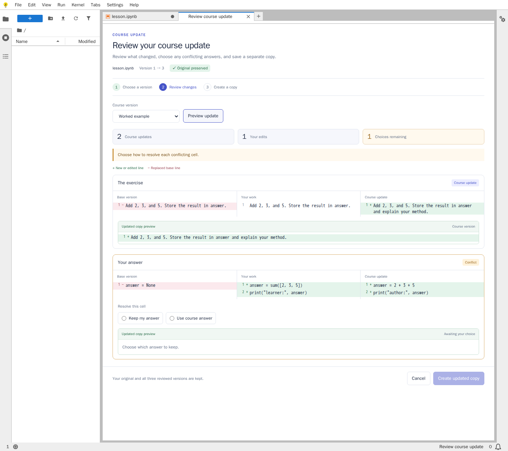
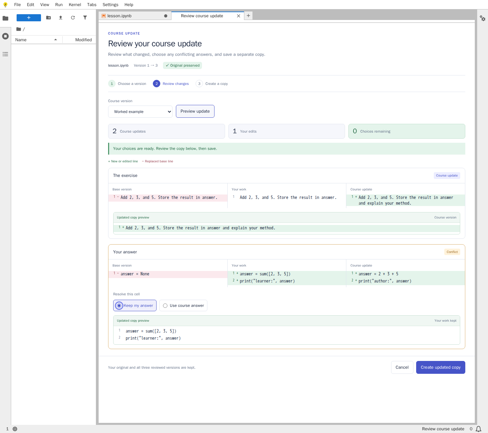
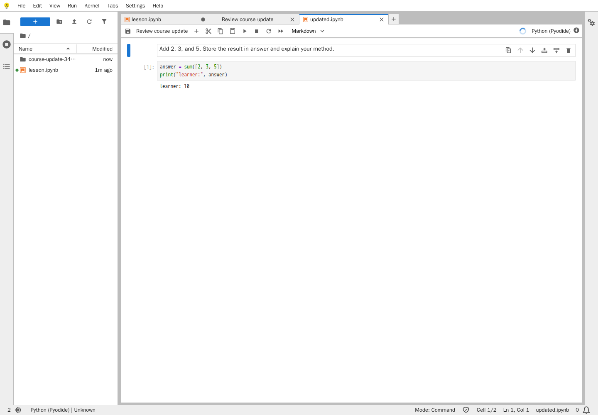

# JupyterLite course updates

Review a revised exercise and keep the learner's work.

[Try the demo](https://jabrailkhalil.github.io/jupyterlite-course-updates/lab/index.html?path=lesson.ipynb) · [Download v0.1.0](https://github.com/jabrailkhalil/jupyterlite-course-updates/releases/tag/v0.1.0)



I am a [visiting lecturer at HSE University](https://www.hse.ru/org/persons/1214663338/). I started this for my own notebook-based teaching. The demo uses one small example notebook.

## Try it

1. Open `lesson.ipynb` and change the answer to `answer = 10`.
2. Select **Review course update** in the notebook toolbar.
3. **Updated instructions** changes the exercise and keeps the answer. **Worked example** also changes the answer cell, so you choose which version to keep.
4. Check **Updated copy preview**, then select **Create updated copy**.

The new notebook is saved separately. The original and all three reviewed versions are kept. Changing, saving or moving the original after preview requires a fresh review. Changed code loses its old outputs and execution count.



## What the colours mean

Green lines are new or edited. Rose lines are replaced base text. Written badges identify course updates, learner edits and conflicts; the remaining-choice count controls when a copy can be created. Use Tab, Space and the arrow keys to resolve the radio choices.



## Run a downloaded build

Extract the release archive, then run:

```sh
node scripts/serve_site.mjs
```

Open http://127.0.0.1:4173/lab/index.html. Node 24 is the supported server toolchain. Use HTTP rather than opening HTML directly. Runtime packages are included; running the notebook does not require access to PyPI or a notebook server.

Work belongs to the browser profile and origin. Export important notebooks before clearing browser storage.

## Scope and validation

Version 0.1 supports whole-cell source updates with stable cell IDs and a fixed layout. Adding, deleting or reordering cells, incoming metadata changes and attachments are rejected. Keeping an answer does not prove that it still fits a changed exercise. Copy creation is not an atomic transaction across arbitrary browser tabs.

The supported runtime is Pyodide 314.0.6 / Python 3.14.2 with the Service Worker and Comlink transport. Cross-origin-isolated Atomics transport is outside this release. The included server matches the Pages transport, without COOP/COEP headers. The browser must allow Service Workers.

The portable Lab extension handles review through the document and Contents APIs. A small JupyterLite build addon copies the course manifest and immutable author revisions outside the learner-file overlay. Autosave is disabled in this example.

The [manual validation and deployment workflow](https://github.com/jabrailkhalil/jupyterlite-course-updates/actions/workflows/public-demo.yml) uses the checked-in Python hash lock and npm lock. It builds and tests remotely, checks deliberately faulty variants, and verifies the actual hosted demo after deployment. See [VALIDATION.md](VALIDATION.md) for the checks and [720px screenshot](docs/images/review-narrow.png).

Project code is [BSD-3-Clause](LICENSE). Bundled dependencies keep their own licenses and source notices in [THIRD_PARTY_NOTICES.md](THIRD_PARTY_NOTICES.md).
